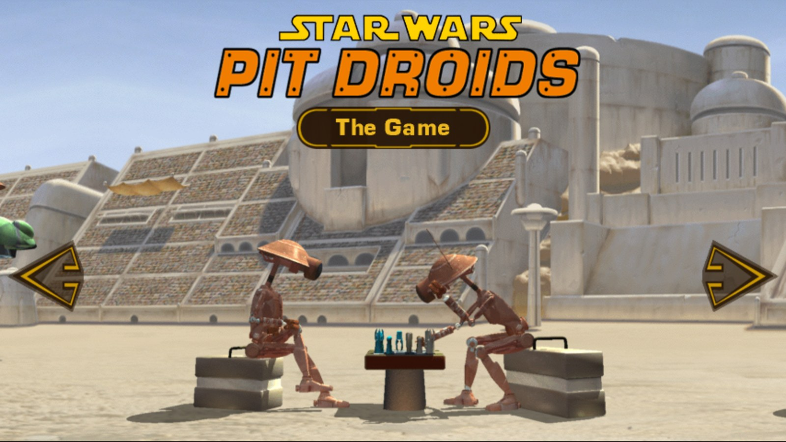
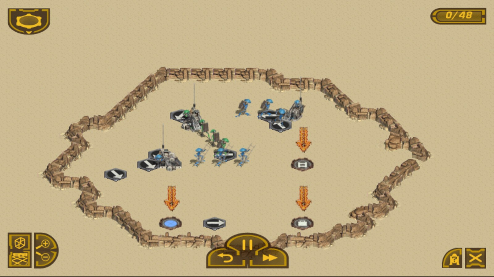
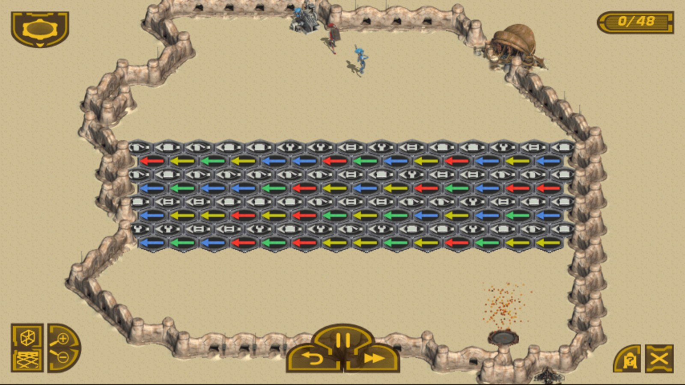
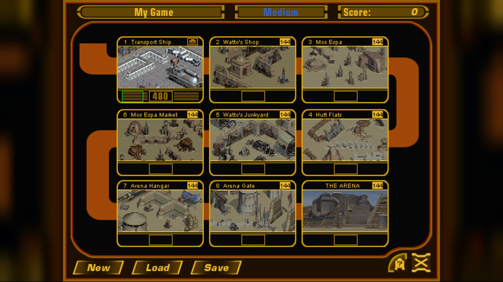
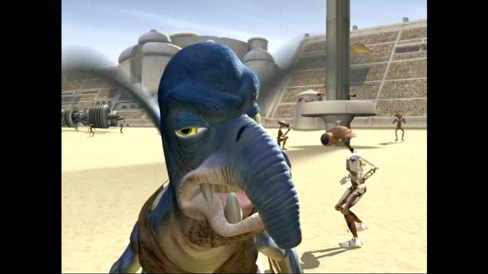
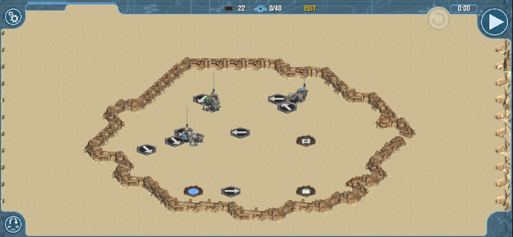

# Pit Droids — fan port (web)

**Play in the browser: https://bloodrabbid.github.io/pitdroids/** — on a computer, tablet or phone.

*Star Wars: Pit Droids* (Lucas Learning, 1999) is a gentle, clever puzzle game about the clumsy little pit
droids from *The Phantom Menace*. The droids march across the board on their own; you place arrows —
plain, coloured, numbered, ratio — so that every droid reaches the exit that matches it: by colour, head shape or
the tool it carries. It starts easy and soon asks for real thinking: keys and locks, fans, paint and tool
changers, counters, sorting lines. More than 300 puzzles across nine locations of Tatooine on the way to the
arena, a training area with C-3PO, hints from R2-D2, the original cutscenes, music and voices.

| | |
|---|---|
|  |  |
|  |  |

This port re-implements the original engine in TypeScript — the puzzles play exactly like the 1999 game
(every official solution passes), with the original art, sound and movies, a touch interface for phones and
tablets, offline play, and a Russian translation.

## How to play
This repository holds only the built engine. **No files of the original game are included** —
graphics, sound, movies, puzzles and texts belong to their owners. On the first visit you point the page
at **your own copy of the game** — the installed folder or the CD, a disc image (.iso / .bin), a .zip, or
the iPhone/iPad app (.ipa); several copies can be combined (e.g. English and a Russian translation). The
page converts it to the game's files right in the browser — nothing is uploaded anywhere — keeps them
there, and the game then works offline (installable as an app). A data pack made from your copy works too.

## По-русски
*Star Wars: Pit Droids* (1999) — добрая и умная головоломка про неуклюжих питдроидов из «Скрытой угрозы».
Дроиды сами идут по полю, а вы расставляете стрелки, чтобы каждый дошёл до своего выхода — по цвету, форме
головы, инструменту. Больше 300 головоломок на девяти локациях Татуина, тренировка с C-3PO, подсказки R2-D2,
оригинальные ролики, музыка и голоса, русский язык. Играть — https://bloodrabbid.github.io/pitdroids/ ;
нужна своя копия игры (папка, диск, образ, .zip или .ipa iOS-версии), сайт сам соберёт из неё игру прямо в
браузере, ничего никуда не отправляя.

## Third-party code
The Sorenson Video 1 movie decoder is a TypeScript port of FFmpeg's `libavcodec/svq1dec.c` and its tables
and is licensed under the GNU Lesser General Public License 2.1 or later. Its source is in
[`source/svq1/`](source/svq1/) (with the license text); the rest of the engine is a separate work.

Not affiliated with or endorsed by Lucasfilm or Disney. Screenshots show the original game running in this port.
